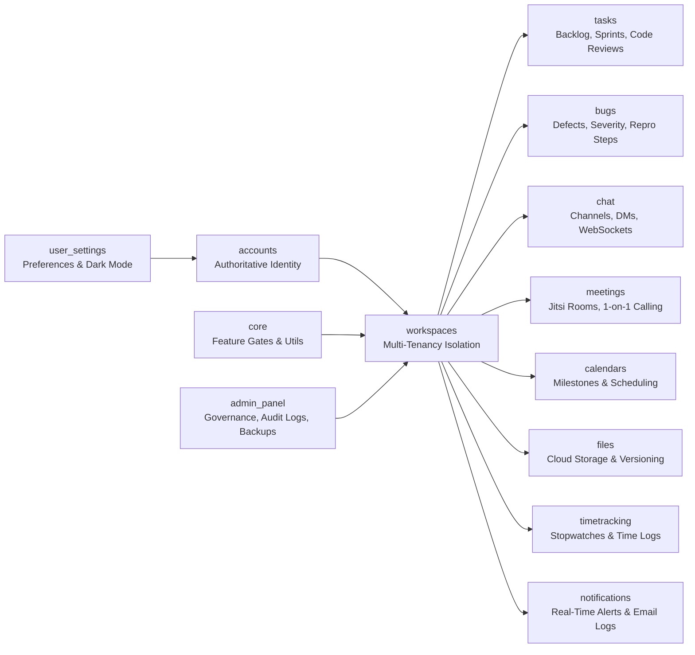

# AetherSpace System Architecture

## 1. High-Level Architectural Overview

AetherSpace is architected as an asynchronous, monolithic web application leveraging **Django 4.2 LTS**, **Django Channels 4**, and **Daphne ASGI**. The platform couples server-side rendered (SSR) templates with real-time bidirectional WebSocket event streams, backed by **Supabase PostgreSQL** for relational persistence and **Supabase Storage** for binary asset handling.

```mermaid
flowchart TB
    subgraph Client["Client Browser"]
        HTML["Django SSR (Tailwind CSS)"]
        Alpine["Alpine.js Interactive Components"]
        Jitsi["Jitsi Meet External API IFrame"]
        WS["WebSocket Client"]
    end

    subgraph Server["Render Application Container (Daphne ASGI)"]
        Daphne["Daphne ASGI Server (Port $PORT)"]
        HTTPRouter["Django HTTP Request Pipeline"]
        WSRouter["Django Channels ProtocolTypeRouter"]
        ORM["Django ORM (psycopg2-binary)"]
    end

    subgraph Data["Supabase Cloud Infrastructure"]
        Postgres[("Supabase PostgreSQL (Port 5432)")]
        Storage[("Supabase Object Storage (REST API)")]
    end

    subgraph Media["External Conferencing"]
        JitsiSFU["Jitsi Media Bridge (meet.jit.si / 8x8.vc JaaS)"]
    end

    Client -->|HTTPS| Daphne
    WS -->|WSS| Daphne
    Jitsi <-->|WebRTC SFU Media| JitsiSFU
    
    Daphne --> HTTPRouter
    Daphne --> WSRouter
    
    HTTPRouter --> ORM
    WSRouter --> ORM
    
    ORM --> Postgres
    HTTPRouter -->|File Uploads (HTTPS)| Storage
```

---

## 2. Request Lifecycle

### HTTP Request Lifecycle
1. **Client Request**: Browser initiates HTTPS request to Render's reverse proxy, which terminates SSL and forwards traffic to the Daphne process listening on `$PORT`.
2. **Security & Session Middleware**:
   - `SecurityMiddleware`: Validates SSL proxy headers (`HTTP_X_FORWARDED_PROTO`) and applies HSTS/X-Frame-Options headers.
   - `WhiteNoiseMiddleware`: Intercepts and serves static assets (`/static/*`) with long-lived caching headers.
   - `SessionMiddleware`: Deserializes user session from `sessionid` cookie stored in PostgreSQL.
   - `AuthenticationMiddleware`: Resolves `request.user` via the custom `accounts.User` model.
   - `CSRFViewMiddleware`: Enforces CSRF token validation on state-changing methods (`POST`, `PUT`, `DELETE`).
   - `WorkspaceMiddleware` & Decorators: Validates membership via `@workspace_member_required`.
3. **View & Service Dispatch**: The matched view function queries the database through the Django ORM using `select_related()` and `prefetch_related()` to avoid N+1 queries.
4. **Template Rendering**: The view passes Python context dictionaries to Django templates, producing the final HTML payload styled with Tailwind utility classes.
5. **Client Rehydration**: Alpine.js boots in the browser, binding interactive state (dropdowns, modals, tabs) directly to DOM attributes (`x-data`, `x-show`, `@click`).

### WebSocket Event Lifecycle
1. **Connection Handshake**: Browser opens WebSocket connection to `wss://<host>/ws/...`.
2. **Protocol Routing**: `aetherspace.asgi.py` routes the socket to `AuthMiddlewareStack`, which authenticates the user from session cookies.
3. **Consumer Execution**:
   - `/ws/chat/c/<channel_id>/` & `/ws/chat/dm/<conv_id>/`: Handled by `ChatConsumer`.
   - `/ws/calls/global/`: Handled by `GlobalCallConsumer` across all authenticated pages.
   - `/ws/meetings/<slug>/<code/>`: Handled by `MeetingSignalingConsumer`.
4. **Channel Layer Dispatch**: Events are broadcast to channel layer groups (e.g. `user_calls_<uuid>`, `chat_<uuid>`), relaying JSON payloads to connected clients instantaneously.

---

## 3. Application Boundaries & Responsibilities

The codebase is partitioned into distinct, modular Django applications:



| Application | Domain Responsibility |
|---|---|
| **`accounts`** | Custom `User` identity, Contributor ID generation (`#####C`), registration approvals, profile avatars. |
| **`core`** | Feature availability toggles (`ModuleStatus`), base error handlers (400, 403, 404, 500), Supabase client utilities. |
| **`workspaces`** | Multi-tenant isolation boundary, `WorkspaceMembership`, role authorization, invitations, and access requests. |
| **`tasks`** | Sprint iterations, 6-digit tasks (`######`), subtasks, activity logs, task comments, and PR code reviews (`CR-######`). |
| **`bugs`** | Defect triage with B-prefix IDs (`B-######`), severities (Sev 1–4), repro steps, and bi-directional task linkages. |
| **`chat`** | Persistent channels, 1-on-1 direct messages, attachments, emoji reactions, and `ChatConsumer` WebSockets. |
| **`meetings`** | Standup conferencing, hybrid Jitsi Media IFrame, 1-on-1 `CallSession` state machine, and `GlobalCallConsumer`. |
| **`calendars`** | Standalone calendar events, milestones, work sessions, agenda tracking, and cross-entity deadline sync. |
| **`files`** | Folders, file versioning, direct user shares, external resource links, and Supabase cloud storage synchronization. |
| **`timetracking`**| Live running stopwatches, manual entries against tasks, and sprint labor accumulation analytics. |
| **`notifications`**| User-centric notifications, badge counts, and email delivery audit logging (`EmailDeliveryLog`). |
| **`admin_panel`** | System console, user approval queues, immutable `AuditLog` records, system alerts, and full JSON backups. |
| **`user_settings`**| User preferences, notification thresholds, timezone settings, and theme toggling (Obsidian Dark vs Light). |

---

## 4. Database & Storage Architecture

### Database Strategy (PostgreSQL via Supabase)
* **Authoritative Identity**: PostgreSQL is the single source of truth for all structured data.
* **UUID Primary Keys**: All internal relational models use `UUIDField(default=uuid.uuid4, editable=False)` to prevent enumeration attacks and support distributed creation.
* **Human-Facing Identifiers**:
  - Tasks: Strict 6-digit numeric IDs (e.g. `619347`).
  - Bugs: B-prefix with 6-digit numeric IDs (e.g. `B-882316`).
  - Code Reviews: CR-prefix with task code (e.g. `CR-619347`).
  - Contributor ID: 5 numeric digits + `C` suffix (e.g. `26457C`).
* **Connection Pooling**: `CONN_MAX_AGE=0` in production settings to support Supabase's transaction pooler (PgBouncer) without connection starvation.

### Storage Strategy (Supabase Cloud Object Storage)
* **Metadata vs Binary Separation**: Binary file payloads are **never** stored inside PostgreSQL. Files are streamed to the `aetherspace-storage` bucket in Supabase Storage.
* **Security**: Supabase service-role keys are strictly server-side and never exposed to browser JavaScript. File downloads and previews are proxied through authenticated Django endpoints (`files:file_download`, `files:file_preview`).

---

## 5. Security & Isolation Boundaries

1. **Workspace Boundary**: Every core entity is foreign-keyed to `Workspace`. A user cannot view, edit, or delete any entity unless they have an active `WorkspaceMembership` in that specific workspace.
2. **Server-Side Enforcement**: All permissions are validated in Python view code and WebSocket consumers; hidden UI buttons never serve as the sole security boundary.
3. **CSRF & Input Sanitization**:
   - All state-changing forms require ``.
   - User-submitted markdown and HTML are sanitized via `bleach` and `markdown` libraries to prevent Cross-Site Scripting (XSS).
4. **Environment Isolation**: No production passwords, secret keys, or API tokens are committed to source control. All configuration is supplied via environment variables.
