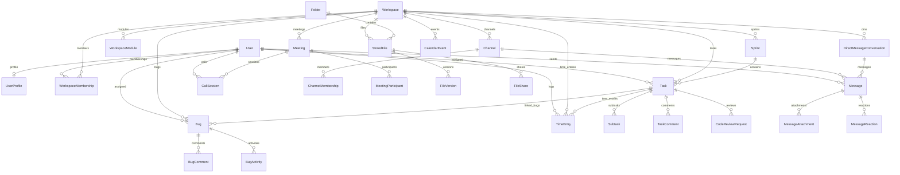

# AetherSpace Database Schema & Data Dictionary

This document provides the authoritative data dictionary and relational schema for the AetherSpace platform, as verified against the Django models and migrations in the active repository.

---

## 1. Schema Design Principles

1. **UUID Relational Keys**: All models utilize `UUIDField(primary_key=True, default=uuid.uuid4, editable=False)` for internal relational identity. This prevents ID enumeration attacks and ensures clean distributed creation.
2. **Standardized Human Identifiers**:
   - Tasks: 6-digit numeric codes (`619347`).
   - Bugs: B-prefix with 6-digit numeric codes (`B-882316`).
   - Contributor ID: 5-digit numeric code with `C` suffix (`26457C`).
   - Meeting Code: `meet-xxxx-xxxx`.
3. **Workspace Data Isolation**: Every operational entity holds a foreign key to `workspaces.Workspace` with `on_delete=models.CASCADE`.
4. **Binary Asset Separation**: Binary files are never stored in PostgreSQL. Files reside in Supabase Cloud Object Storage; PostgreSQL holds only metadata records.
5. **Auditability**: Critical business entities include `created_at`, `updated_at`, and corresponding activity/audit logs.

---

## 2. Core & Identity Domain (`accounts`, `core`)

### 2.1 `accounts.User`
* **App**: `accounts`
* **Purpose**: Authoritative Custom User model extending Django `AbstractUser`.
* **Primary Key**: `id` (`UUIDField`)
* **Fields**:
  - `email` (`EmailField`, unique=True, db_index=True) — Primary authentication field.
  - `full_name` (`CharField(max_length=255, blank=True)`)
  - `contributor_id` (`CharField(max_length=10, unique=True, db_index=True)`) — Unique `#####C` ID (e.g. `26457C`).
  - `role` (`CharField(max_length=20, default='CONTRIBUTOR')`) — Choices: `ADMIN`, `MANAGER`, `CONTRIBUTOR`.
  - `approval_status` (`CharField(max_length=20, default='PENDING', db_index=True)`) — Choices: `PENDING`, `APPROVED`, `REJECTED`, `SUSPENDED`.
  - `avatar` (`CharField(max_length=1024, blank=True)`) — Supabase path, URL, or preset.
  - `timezone` (`CharField(max_length=50, default='UTC')`)
  - `is_verified` (`BooleanField(default=False)`)
  - `approved_by` (`ForeignKey('self', null=True, on_delete=SET_NULL)`)
  - `approved_at` (`DateTimeField(null=True)`)
  - `created_at`, `updated_at` (`DateTimeField`)
* **Methods**: `get_full_name()`, `get_short_name()`, `is_approved`, `is_pending_approval`.
* **Associated Migrations**: `accounts/migrations/0001_initial.py`.

### 2.2 `accounts.UserProfile`
* **App**: `accounts`
* **Purpose**: Extended personal profile and presence preferences.
* **Fields**:
  - `user` (`OneToOneField(User, on_delete=CASCADE, related_name='profile')`)
  - `bio` (`TextField(blank=True)`)
  - `phone` (`CharField(max_length=32, blank=True)`)
  - `headline` (`CharField(max_length=255, blank=True)`)
  - `banner` (`CharField(max_length=1024, blank=True)`)
  - `preferences` (`JSONField(default=dict)`) — Holds `status` ('available', 'in_meeting', 'offline'), theme preferences, expiry.
* **Methods**: `availability_status`, `status_message`.

### 2.3 `core.ModuleStatus`
* **App**: `core`
* **Purpose**: Global operational availability toggles for features.
* **Fields**:
  - `module_key` (`CharField(max_length=50, unique=True)`) — e.g. `meetings`, `chat`, `tasks`.
  - `name` (`CharField(max_length=100)`)
  - `status` (`CharField(max_length=30, default='AVAILABLE')`) — `AVAILABLE`, `MAINTENANCE`, `COMING_SOON`.
  - `public_message` (`CharField(max_length=255, blank=True)`)
  - `maintenance_explanation` (`TextField(blank=True)`)
  - `updated_by` (`ForeignKey(User, null=True, on_delete=SET_NULL)`)

---

## 3. Workspaces & Access Control (`workspaces`)

### 3.1 `workspaces.Workspace`
* **App**: `workspaces`
* **Purpose**: Multi-tenant team and project container.
* **Fields**:
  - `name` (`CharField(max_length=100)`)
  - `slug` (`SlugField(max_length=120, unique=True, db_index=True)`)
  - `description` (`TextField(blank=True)`)
  - `owner` (`ForeignKey(User, on_delete=PROTECT)`)
  - `status` (`CharField(max_length=20, default='ACTIVE')`) — `ACTIVE`, `ARCHIVED`, `SUSPENDED`.
  - `max_seats` (`PositiveIntegerField(default=15)`)
  - `storage_quota_mb` (`PositiveIntegerField(default=50)`)
  - `tech_stack` (`CharField(max_length=500, blank=True)`)
  - `project_scope` (`TextField(blank=True)`)
  - `architecture_notes` (`TextField(blank=True)`)
  - `logo` (`CharField(max_length=1024, blank=True)`)
* **Properties**: `seats_assigned`, `seats_remaining`, `storage_quota_bytes`, `logo_url`.

### 3.2 `workspaces.WorkspaceMembership`
* **App**: `workspaces`
* **Purpose**: Relates a User to a Workspace with a role.
* **Fields**:
  - `workspace` (`ForeignKey(Workspace, on_delete=CASCADE)`)
  - `user` (`ForeignKey(User, on_delete=CASCADE)`)
  - `role` (`CharField(max_length=20, default='CONTRIBUTOR')`) — `ADMIN`, `MANAGER`, `CONTRIBUTOR`.
  - `status` (`CharField(max_length=20, default='ACTIVE')`) — `ACTIVE`, `SUSPENDED`.
  - `functional_role` (`CharField(max_length=100, blank=True)`) — e.g. "Backend Engineer".
  - `role_tag` (`CharField(max_length=50, blank=True)`) — e.g. "Backend".
  - `reporting_to` (`ForeignKey('self', null=True, on_delete=SET_NULL)`)
  - `joined_at` (`DateTimeField(auto_now_add=True)`)
* **Constraints**: `unique_together = ('workspace', 'user')`.

### 3.3 `workspaces.WorkspaceModule`
* **App**: `workspaces`
* **Purpose**: Workspace-scoped subsystem tags for bug triage.
* **Fields**:
  - `workspace` (`ForeignKey(Workspace, on_delete=CASCADE)`)
  - `name` (`CharField(max_length=100)`)
  - `is_active` (`BooleanField(default=True)`)

### 3.4 `workspaces.GlobalAccessRequest` & `TemporaryAccessGrant`
* **App**: `workspaces`
* **Purpose**: Auditable time-bounded privilege requests without permanent role elevation.
* **Fields**:
  - `action`: `task.create`, `task.edit`, `bug.create`, `file.upload`, `workspace.access`, etc.
  - `urgency`: `NORMAL`, `URGENT`, `EMERGENCY`.
  - `requested_duration`: `ONE_TIME`, `1_HOUR`, `4_HOURS`, `TODAY`, `CUSTOM`.
  - `status`: `PENDING`, `APPROVED`, `REJECTED`, `EXPIRED`.

---

## 4. Agile Tasks & Sprints (`tasks`)

### 4.1 `tasks.Sprint`
* **App**: `tasks`
* **Purpose**: Timeboxed agile iteration.
* **Fields**:
  - `workspace` (`ForeignKey(Workspace, on_delete=CASCADE)`)
  - `name` (`CharField(max_length=100)`) — e.g. "Sprint 04".
  - `goal` (`TextField(blank=True)`)
  - `status` (`CharField(max_length=20, default='PLANNING')`) — `PLANNING`, `ACTIVE`, `COMPLETED`, `CANCELLED`.
  - `start_date`, `end_date` (`DateField(null=True)`)
  - `created_by` (`ForeignKey(User, null=True, on_delete=SET_NULL)`)

### 4.2 `tasks.Task`
* **App**: `tasks`
* **Purpose**: 6-digit sprint backlog task.
* **Fields**:
  - `task_code` (`CharField(max_length=10, unique=True, db_index=True)`) — 6 digits (e.g. `619347`).
  - `workspace` (`ForeignKey(Workspace, on_delete=CASCADE)`)
  - `title` (`CharField(max_length=255)`)
  - `description` (`TextField(blank=True)`)
  - `status` (`CharField(max_length=20, default='TODO')`) — `TODO`, `IN_PROGRESS`, `CODE_REVIEW`, `TESTING`, `DONE`.
  - `priority` (`CharField(max_length=20, default='MEDIUM')`) — `LOW`, `MEDIUM`, `HIGH`, `URGENT`.
  - `assignee`, `reporter` (`ForeignKey(User, null=True, on_delete=SET_NULL)`)
  - `sprint_ref` (`ForeignKey(Sprint, null=True, on_delete=SET_NULL)`)
  - `due_date` (`DateField(null=True)`)
  - `estimated_hours` (`DecimalField(max_digits=5, decimal_places=2, null=True)`)
  - `tags` (`CharField(max_length=255, blank=True)`)

### 4.3 `tasks.Subtask` & `tasks.TaskActivity` & `tasks.TaskComment`
* **Subtask**: `task`, `title`, `is_completed`, `order`.
* **TaskActivity**: `task`, `actor`, `action`, `old_value`, `new_value`, `message`.
* **TaskComment**: `task`, `author`, `comment_type` (`USER`/`SYSTEM`), `content`, `metadata`.

### 4.4 `tasks.CodeReviewRequest`
* **App**: `tasks`
* **Purpose**: Pull Request review linked to a Task.
* **Fields**:
  - `review_code` (`CharField(max_length=20, unique=True)`) — e.g. `CR-619347`.
  - `task` (`ForeignKey(Task, on_delete=CASCADE)`)
  - `requester`, `reviewer` (`ForeignKey(User)`)
  - `github_pr_url` (`URLField(max_length=500)`)
  - `status` (`CharField(max_length=30)`) — `REQUESTED`, `IN_REVIEW`, `CHANGES_REQUESTED`, `APPROVED`, `MERGED`, `CLOSED`.

---

## 5. Defect Management (`bugs`)

### 5.1 `bugs.Bug`
* **App**: `bugs`
* **Purpose**: B-prefix defect triage record.
* **Fields**:
  - `bug_code` (`CharField(max_length=12, unique=True, db_index=True)`) — e.g. `B-882316`.
  - `workspace` (`ForeignKey(Workspace, on_delete=CASCADE)`)
  - `title` (`CharField(max_length=255)`)
  - `steps_to_reproduce`, `expected_result`, `actual_result` (`TextField`)
  - `status` (`CharField(max_length=20, default='OPEN')`) — `OPEN`, `IN_PROGRESS`, `RESOLVED`, `CLOSED`.
  - `priority` (`CharField(max_length=20, default='MEDIUM')`) — `LOW`, `MEDIUM`, `HIGH`, `CRITICAL`.
  - `severity` (`CharField(max_length=20, default='SEV3')`) — `SEV1`, `SEV2`, `SEV3`, `SEV4`.
  - `environment` (`CharField(max_length=20)`) — `PRODUCTION`, `STAGING`, `DEVELOPMENT`, `QA`.
  - `module` (`ForeignKey('workspaces.WorkspaceModule', null=True, on_delete=SET_NULL)`)
  - `linked_task` (`ForeignKey('tasks.Task', null=True, on_delete=SET_NULL)`)
  - `reporter`, `assignee` (`ForeignKey(User, null=True, on_delete=SET_NULL)`)
  - `browser_device` (`CharField(max_length=255, blank=True)`)
  - `due_date` (`DateField(null=True)`)
* **Constraints**: Model `clean()` enforces that `module` and `linked_task` belong to the same workspace.

---

## 6. Team Chat & Channels (`chat`)

### 6.1 `chat.Channel` & `chat.ChannelMembership`
* **Channel**: `workspace`, `name`, `slug`, `is_private`, `who_can_post` (`ALL`/`ADMIN_ONLY`), `created_by`.
* **ChannelMembership**: `channel`, `user`, `role` (`OWNER`, `ADMIN`, `MEMBER`), `last_read_at`.

### 6.2 `chat.DirectMessageConversation`
* **Fields**: `workspace`, `participant1`, `participant2`.
* **Invariant**: Canonical ordering `participant1.id < participant2.id` prevents duplicate reversed conversations.

### 6.3 `chat.Message`, `chat.MessageAttachment`, `chat.MessageReaction`
* **Message**: `workspace`, `channel` (optional), `conversation` (optional), `sender`, `recipient`, `content`, `is_pinned`, `is_deleted`.
* **MessageAttachment**: `message`, `file`, `file_name`, `file_size`, `mime_type`, `is_image`.
* **MessageReaction**: `message`, `user`, `emoji`. Unique constraint on `(message, user, emoji)`.

---

## 7. Real-Time Conferencing (`meetings`)

### 7.1 `meetings.Meeting`
* **Fields**:
  - `meeting_code` (`CharField(max_length=20, unique=True, db_index=True)`) — e.g. `meet-k7xp-2m9q`.
  - `workspace` (`ForeignKey(Workspace, on_delete=CASCADE)`)
  - `title` (`CharField(max_length=255)`)
  - `host` (`ForeignKey(User, null=True, on_delete=SET_NULL)`)
  - `meeting_type` (`CharField(max_length=30)`) — `INSTANT`, `STANDUP`, `SPRINT_PLANNING`, `RETROSPECTIVE`, `CHAT_CALL`, `GENERAL`.
  - `status` (`CharField(max_length=20, default='SCHEDULED')`) — `SCHEDULED`, `LIVE`, `ENDED`, `CANCELLED`.
  - `scheduled_start`, `scheduled_end`, `actual_start`, `actual_end` (`DateTimeField`)
  - `is_audio_only` (`BooleanField(default=False)`)
  - `channel` (`ForeignKey('chat.Channel', null=True, on_delete=SET_NULL)`)
* **Property**: `jitsi_room_name` — Deterministic hash `AetherSpace_<slug>_<code>_<sha256>`.

### 7.2 `meetings.MeetingParticipant`
* **Fields**: `meeting`, `user`, `role` (`HOST`/`ATTENDEE`), `joined_at`, `left_at`, `is_hand_raised`, `is_removed`.

### 7.3 `meetings.CallSession`
* **Fields**:
  - `workspace`, `caller`, `recipient`, `meeting`, `conversation`, `channel`.
  - `call_mode`: `AUDIO`, `VIDEO`.
  - `status`: `RINGING`, `ACCEPTED`, `CONNECTED`, `DECLINED`, `MISSED`, `CANCELLED`, `ENDED`, `FAILED`.
  - `ended_reason`: `NORMAL`, `DECLINED`, `TIMEOUT`, `CANCELLED`, `BUSY`, `FAILED`.
  - `created_at`, `ringing_at`, `accepted_at`, `connected_at`, `ended_at`, `missed_at`.

---

## 8. Files, Calendars, Time Tracking & Admin

| Model | Application | Purpose | Key Relational Pointers |
|---|---|---|---|
| **`Folder`** | `files` | Nested folders | `workspace`, `parent` (self) |
| **`StoredFile`** | `files` | Supabase metadata & external links | `workspace`, `folder`, `uploaded_by` |
| **`FileVersion`** | `files` | Historical revisions | `file`, `uploaded_by`, `version_number` |
| **`FileShare`** | `files` | User-to-user sharing | `file`, `shared_with`, `shared_by`, `access_level` |
| **`CalendarEvent`** | `calendars` | Events & milestones | `workspace`, `linked_task`, `linked_bug`, `linked_meeting` |
| **`CalendarEventAttendee`** | `calendars` | Event invitations | `event`, `user`, `status` (`INVITED`, `ACCEPTED`, etc.) |
| **`TimeEntry`** | `timetracking` | Stopwatches & logs | `workspace`, `user`, `task`, `duration_seconds`, `is_running` |
| **`Notification`** | `notifications` | Cross-module alerts | `workspace`, `recipient`, `actor`, `category`, `is_read` |
| **`EmailDeliveryLog`** | `notifications` | Outbound email audit | `recipient_email`, `event_type`, `status` (`SENT`, `FAILED`) |
| **`AuditLog`** | `admin_panel` | Immutable system audit | `actor`, `action`, `target_type`, `workspace`, `metadata` |
| **`AdminAlert`** | `admin_panel` | System alerts | `workspace`, `severity`, `category`, `is_resolved` |
