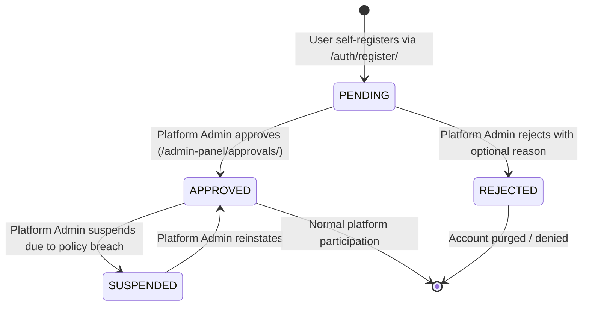
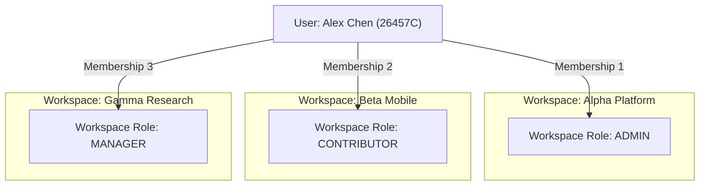

# AetherSpace Authentication, Identity & RBAC Architecture

This document details the identity lifecycle, authentication mechanisms, and Role-Based Access Control (RBAC) rules enforced across AetherSpace.

---

## 1. Authoritative Identity & Contributor IDs

AetherSpace uses a single authoritative identity model anchored in `accounts.User` extending Django's `AbstractUser`.

### 1.1 Contributor ID Specification
* **Format**: Exactly 5 numeric digits followed by an uppercase letter `C` (e.g. `26457C`, `91823C`).
* **Generation**: Implemented in `accounts/models.py` (`generate_unique_contributor_id()`) using cryptographically secure random integers (`secrets.randbelow(90000) + 10000`) with duplicate collision handling (up to 100 retries).
* **Usage**: Contributor ID is indexed (`db_index=True`, `unique=True`) and serves as the primary human identifier for logins, mentions, team hover cards, and audit entries.

### 1.2 Dual Login Identifier Support
Users can authenticate using either their **Contributor ID** or their **Email address**:
* Both inputs are accepted in the single login field at `/auth/login/`.
* `accounts.backends.ContributorOrEmailBackend` (or custom login view logic) tests input format: if ending with `C` and 6 characters long, it matches on `contributor_id`; otherwise, it matches on normalized `email`.

---

## 2. User Lifecycle & Approval State Machine

### State Machine Rules
1. **Self-Registration**: New registrations default to `approval_status = PENDING`.
2. **Access Barrier**: A user whose `approval_status == PENDING` cannot access any workspace, task, chat, or API. When attempting to log in, they are redirected to `/auth/pending-approval/`.
3. **Approval Action**: When an Administrator clicks "Approve", `approval_status` transitions to `APPROVED`, `approved_by` records the admin user, and `approved_at` stores the timestamp.
4. **Superuser Bypass**: Django superusers automatically bypass `PENDING` status upon creation.

---

## 3. Workspace Membership & Multi-Tenancy Isolation

A single user can belong to multiple workspaces, with distinct roles in each:

### Workspace Member Guard (`@workspace_member_required`)
Defined in `workspaces/decorators.py`:
1. Inspects the `slug` kwarg from the URL path.
2. Fetches `Workspace.objects.filter(slug=slug).first()`. If missing, returns 404.
3. Checks `user.is_superuser` or `WorkspaceMembership.objects.filter(workspace=workspace, user=user, status=ACTIVE).first()`.
4. If valid, attaches `request.workspace` and `request.membership` to the request object.
5. If invalid, renders `core/403.html` with an option to submit a `WorkspaceAccessRequest`.

---

## 4. Role-Based Access Control (RBAC) Matrix

| Action / Capability | Platform Admin | Workspace Admin | Workspace Manager | Workspace Contributor |
|---|:---:|:---:|:---:|:---:|
| **Approve / Suspend Users** | ✅ Yes | ❌ No | ❌ No | ❌ No |
| **System Audit Logs & Backups** | ✅ Yes | ❌ No | ❌ No | ❌ No |
| **Module Maintenance Toggles** | ✅ Yes | ❌ No | ❌ No | ❌ No |
| **Edit Workspace Settings / Quotas**| ✅ Yes | ✅ Yes | ❌ No | ❌ No |
| **Invite Workspace Members** | ✅ Yes | ✅ Yes | ❌ No | ❌ No |
| **Create Sprints & Reassign Work** | ✅ Yes | ✅ Yes | ✅ Yes | ❌ No |
| **Create & Edit Tasks / Bugs** | ✅ Yes | ✅ Yes | ✅ Yes | ✅ Yes (Assigned/Created) |
| **Delete Tasks / Bugs** | ✅ Yes | ✅ Yes | ✅ Yes | ❌ No (Request Needed) |
| **Log Work & Live Timer** | ✅ Yes | ✅ Yes | ✅ Yes | ✅ Yes |
| **Send Messages & Upload Files** | ✅ Yes | ✅ Yes | ✅ Yes | ✅ Yes |
| **End Meetings for All (Host)** | ✅ (If in room) | ✅ (If in room) | ✅ (If Host) | ❌ (Host Only) |

---

## 5. Temporary Access Grants (Dynamic RBAC)

When a Contributor needs to perform a privileged action without permanent role escalation (e.g. deleting a task, uploading an emergency hotfix), AetherSpace utilizes `workspaces.GlobalAccessRequest` and `workspaces.TemporaryAccessGrant`:

1. Contributor submits request: action (`task.delete`), reason, urgency (`URGENT`), and duration (`1_HOUR`).
2. Workspace Admin or Platform Admin approves the request.
3. System creates a `TemporaryAccessGrant` with `expires_at = timezone.now() + timedelta(hours=1)`.
4. Contributor's permanent role remains `CONTRIBUTOR`.
5. The view checks `TemporaryAccessGrant.has_active_grant(request.user, request.workspace, 'task.delete')`, permitting the single action before the grant auto-expires.

---

## 6. Security Guarantees & Verification Evidence

* **Server-Side Enforcement**: All permission evaluations occur in Python view code and WebSocket consumers (`validate_meeting_access`, `can_post`). Hidden UI buttons never act as security boundaries.
* **Session Security**:
  - `SESSION_COOKIE_HTTPONLY = True`: Blocks JavaScript access to session cookies.
  - `CSRF_COOKIE_HTTPONLY = False`: Allows Alpine.js / fetch headers to read `csrftoken`.
  - In production (`not DEBUG`), `SESSION_COOKIE_SECURE = True` and `CSRF_COOKIE_SECURE = True`.
* **Testing Evidence**:
  - `tests/test_audit_fixes.py`: Validates RBAC enforcement on admin endpoints.
  - `workspaces/tests.py`: Validates cross-workspace isolation and access requests.
  - `meetings/tests.py`: Validates host-only privileges on meeting termination.
