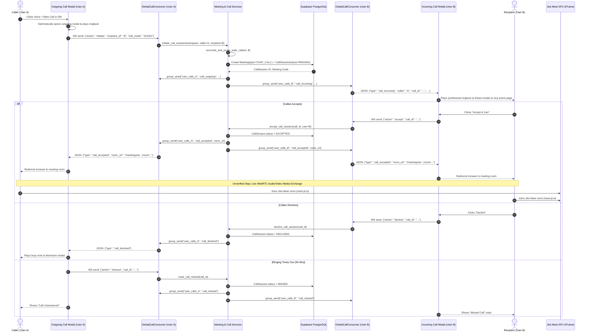

# Module 06: Meet Hub & Video Conferencing

> [!WARNING]
> **OPERATIONAL RELEASE GATE STATUS**: In project governance, Meet Hub is designated as **Gated under Coming Soon** (`ModuleStatus.STATUS_COMING_SOON`). Application-level enforcement is implemented via `check_meetings_maintenance()`. However, live database inspection confirms that the connected remote Supabase PostgreSQL database currently holds `status = 'AVAILABLE'`. In accordance with safety policies prohibiting autonomous modifications of remote databases, the gate is **PENDING OWNER ACTIVATION IN THE LIVE DATABASE**. To enforce the gate before general release, an administrator must update the `meetings` record in `core_modulestatus` to `COMING_SOON` or `MAINTENANCE`.

---

## 1. Purpose
Provides standup video conferencing, audio calls, in-chat calling, and screen sharing for agile teams. Built upon a hybrid architecture pairing a robust Django/Channels application shell with Jitsi Meet's WebRTC SFU engine.

---

## 2. Implementation & Verification Status
* **Backend Architecture**: **Implemented and Tested (Verified)**: 57/57 backend unit tests passing in `meetings` & `tests.test_meeting_webrtc_signaling`. (Note: automated unit tests validate backend state machines and signaling; they do not prove physical audio/video functionality or cross-device hardware streaming).
* **Hardware & Audio Media**: **Unverified** (Live microphone/camera streaming across two separate physical devices awaits owner verification).
* **Release Gate**: **Gated in Code / Pending Remote DB Record Update** (`check_meetings_maintenance()` enforces gating when `ModuleStatus` is `COMING_SOON` or `MAINTENANCE`; connected remote DB currently holds `AVAILABLE`).
* **JaaS (8x8) Integration**: **Planned / Unimplemented** (Architecture audited; server-side RS256 JWT signing, tenant prefixing, and key configurations are not implemented in active codebase).

---

## 3. Two Distinct Calling Call Paths

AetherSpace implements two clearly separated calling paths depending on the context:

### Path A: 1-on-1 Direct Message Instant Calling (Global Ringing Modal)
* **Trigger**: Click Voice or Video Call in Direct Message header (`direct_message.html`).
* **Mechanism**: Dispatches `aetherspace:initiate_call` DOM CustomEvent.
* **Signaling**: Handled by `GlobalCallConsumer` over WebSocket at `/ws/calls/global/`.
* **Behavior**:
  - Caller sees optimistic outgoing modal with ringing audio synthesis.
  - Callee receives real-time incoming ringtone modal across **any** authenticated page of AetherSpace.
  - Callee clicks "Accept & Join" -> Both peers navigate to the generated meeting room.
  - State machine: `RINGING` -> `ACCEPTED` -> `CONNECTED` -> `ENDED` (or `DECLINED` / `MISSED` / `CANCELLED`).

### Path B: Channel & Scheduled Group Meetings (In-Chat Meeting Cards)
* **Trigger**: Click Call button in Channel header (`channel_view.html`) or "Start Instant Meeting" in Meet Hub.
* **Mechanism**: Submits form POST to `meeting_chat_call_routed` / `meeting_start_view`.
* **Behavior**:
  - System creates `Meeting` with `meeting_type = 'CHAT_CALL'`.
  - Automatically posts a joinable meeting card into the channel's message stream so all channel members can join.
  - Creator is redirected immediately into the meeting room as the Host.

---

## 4. Call Sequence & Lifecycle Diagram

---

## 5. Phase 3.1 Forensic Remediation Findings

During actual two-user manual testing, several critical defects were identified and remediated in code:

| Defect Observed in Manual Testing | Root Cause Diagnosed | Verified Code Remediation |
|---|---|---|
| **Call Disappearance (~1s)** | Form submit event race bypassed JavaScript CustomEvent; stale orphaned `CallSession` in DB blocked new calls with validation error. Outgoing modal dismissed immediately on error. | 1. Replaced `<form>` buttons with `type="button"` dispatching `aetherspace:initiate_call`. 2. Added `reconcile_and_prune_stale_calls()` to auto-prune stale sessions. 3. Outgoing modal retains error notices for 3.0s prior to dismissal. |
| **Phantom Participant ("AetherSpace Contributor")** | `configOverwrite.defaultRemoteDisplayName` was hardcoded to "AetherSpace Contributor"; stale tabs or iframe double initialization rendered extra peers. | 1. Changed `defaultRemoteDisplayName` to "Team Member". 2. Replaced static DB participant badge with dynamic `jitsiApi.getNumberOfParticipants()` listener. |
| **Acoustic Feedback / Audio Echo** | Multiple browser tabs open to the same room on the same machine accessing microphone/speaker simultaneously. | 1. Implemented `BroadcastChannel('aether_meet_<code>')` detecting another active tab and displaying an amber warning banner. **Critical implementation behavior**: The warning mitigates accidental duplicate sessions but does not hard-abort Jitsi initialization merely because the warning appears; a second tab may therefore still create an additional media session if the warning is ignored. 2. Enforced Jitsi `enableEchoCancellation: true` and `enableNoiseSuppression: true`. |
| **5-Minute Disconnection Warning** | 8x8's public `meet.jit.si` domain enforces a mandatory 5-minute timeout on all anonymous iframe embeds. | Added informational banner in room view explaining the public demo mode constraint; prepared JaaS RS256 migration plan. |
| **Moderator Login Prompt** | 8x8's public domain requires moderator login for new anonymous rooms to prevent abuse. | Documented that this external infrastructure limitation is resolved upon JaaS JWT activation (where moderator rights are provided in token claims, e.g. `context.user.moderator: true` [Needs verification against active provider schema]). |

---

## 6. JaaS (8x8) Migration Status & Architectural Blueprint (Planned - Not Implemented)

The current codebase does **not** implement JaaS integration or server-side JWT signing.

### Currently Implemented Configuration:
* `JITSI_DOMAIN`: Configured in `aetherspace/settings.py` (defaults to public `meet.jit.si`).
* `JITSI_MEET_ENABLED`: Boolean toggle in `aetherspace/settings.py`.
* `JITSI_APP_ID`: Setting present as an unused placeholder string in `settings.py`; not consumed in room prefixing or token logic.
* Public IFrame Integration: `templates/meetings/meeting_room.html` loads script from `https://{{ jitsi_domain }}/external_api.js` without JWT authentication.

### Planned JaaS Settings & Requirements (Future Phase):
1. **Dependencies**: Add `PyJWT>=2.8.0` and `cryptography>=42.0.0` to `requirements.txt` (currently not installed).
2. **Environment Variables**:
   - `JAAS_APP_ID`: 8x8 JaaS App ID / tenant identifier (e.g. `vpaas-magic-cookie-...`).
   - `JAAS_API_KEY_ID`: 8x8 JaaS API Key identifier (`kid`).
   - `JAAS_PRIVATE_KEY` / `JAAS_PRIVATE_KEY_PATH`: Secure storage for the RSA private key (PEM format). Must be stored outside Git and outside client code.
3. **RS256 JWT Generation**: Server-side token generator function in `meetings/services.py` to sign tokens using the RSA private key and `kid` header.
4. **Token Claims Structure**:
   - Official 8x8 JaaS specifications require user and moderator claims inside the `context` dictionary:
     `context.user.moderator: true|false` [Needs verification against provider documentation before implementation].
   - Placing `moderator` as a top-level claim is unsupported by standard JaaS validators.
5. **Tenant Room Prefixing**: Room names must be prefixed with the tenant App ID: `f"{JAAS_APP_ID}/{room_name}"`.
6. **External API Script**: Load external API from `https://8x8.vc/external_api.js` (or tenant-specific endpoint).

---

## 7. Pending Manual Verification Checklist (Owner Required)

Before Meet Hub can be ungated:
- [ ] Physical two-device audio clarity check (using headphones or separate rooms).
- [ ] Bidirectional video track delivery verified between two separate users.
- [ ] Screen sharing verified with display-capture permissions.
- [ ] Verification of incoming call ringtone across different pages (Tasks, Chat, Admin).
- [ ] Host meeting termination verifies that attendees are disconnected and meeting status updates to `ENDED`.
