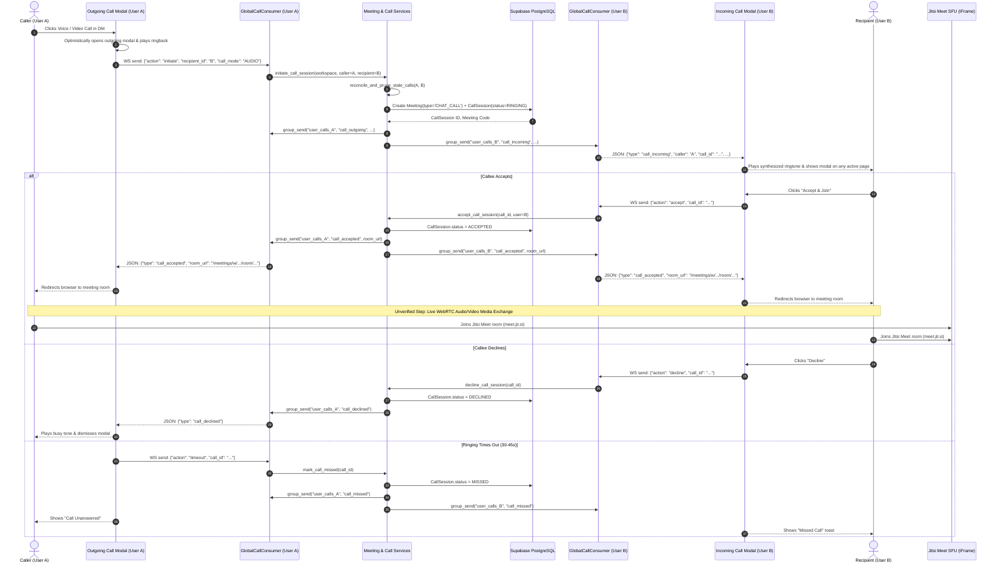

# Module 06: Meet Hub & Video Conferencing

> [!WARNING]
> **OPERATIONAL RELEASE GATE STATUS**: In project governance, Meet Hub is designated as **Gated under Coming Soon** (`ModuleStatus.STATUS_COMING_SOON`). Application-level enforcement is implemented via `check_meetings_maintenance()`. However, live database inspection confirms that the connected remote Supabase PostgreSQL database currently holds `status = 'AVAILABLE'`. In accordance with safety policies prohibiting autonomous modifications of remote databases, the gate is **PENDING OWNER ACTIVATION IN THE LIVE DATABASE**. To enforce the gate before general release, an administrator must update the `meetings` record in `core_modulestatus` to `COMING_SOON` or `MAINTENANCE`.

---

## 1. Purpose
Provides standup video conferencing, audio calls, in-chat calling, and screen sharing for agile teams. Built upon a hybrid architecture pairing a robust Django/Channels application shell with Jitsi Meet's WebRTC SFU engine.

---

## 2. Implementation & Verification Status
* **Backend Architecture**: **Implemented and Tested (Verified)**: 77/77 backend unit tests passing in `meetings` (including full JaaS RS256 JWT token generation, cryptographic validation, room routing, call sessions, and WebSocket signaling consumers).
* **Hardware & Audio Media**: **Unverified** (Live microphone/camera streaming across two separate physical devices awaits owner verification).
* **Release Gate**: **Gated in Code / Pending Remote DB Record Update** (`check_meetings_maintenance()` enforces gating when `ModuleStatus` is `COMING_SOON` or `MAINTENANCE`; connected remote DB currently holds `AVAILABLE`).
* **JaaS (8x8) Integration**: **Implemented and Tested (Verified)**: Server-side RS256 JWT signing, tenant App ID room prefixing (`${JAAS_APP_ID}/${room_name}`), moderator privilege claims (`context.user.moderator`), anti-fallback security isolation, placeholder key detection, and companion workspace navigation.

---

## 3. Two Distinct Calling Call Paths

AetherSpace implements two clearly separated calling paths depending on the context:

### Path A: 1-on-1 Direct Message Instant Calling (Global Ringing Modal)
* **Trigger**: Click Voice or Video Call in Direct Message header (`direct_message.html`).
* **Mechanism**: Dispatches `aetherspace:initiate_call` DOM CustomEvent.
* **Signaling**: Handled by `GlobalCallConsumer` over WebSocket at `/ws/calls/global/`.
* **Behavior**:
  - Caller sees optimistic outgoing modal with ringing audio synthesis.
  - Callee receives real-time incoming ringtone modal across **any** authenticated page of AetherSpace.
  - Callee clicks "Accept & Join" -> Both peers navigate to the generated meeting room.
  - State machine: `RINGING` -> `ACCEPTED` -> `CONNECTED` -> `ENDED` (or `DECLINED` / `MISSED` / `CANCELLED`).

### Path B: Channel & Scheduled Group Meetings (In-Chat Meeting Cards)
* **Trigger**: Click Call button in Channel header (`channel_view.html`) or "Start Instant Meeting" in Meet Hub.
* **Mechanism**: Submits form POST to `meeting_chat_call_routed` / `meeting_start_view`.
* **Behavior**:
  - System creates `Meeting` with `meeting_type = 'CHAT_CALL'`.
  - Automatically posts a joinable meeting card into the channel's message stream so all channel members can join.
  - Creator is redirected immediately into the meeting room as the Host.

---

## 4. Call Sequence & Lifecycle Diagram

---

## 5. Phase 3.1 Forensic Remediation Findings

During actual two-user manual testing, several critical defects were identified and remediated in code:

| Defect Observed in Manual Testing | Root Cause Diagnosed | Verified Code Remediation |
|---|---|---|
| **Call Disappearance (~1s)** | Form submit event race bypassed JavaScript CustomEvent; stale orphaned `CallSession` in DB blocked new calls with validation error. Outgoing modal dismissed immediately on error. | 1. Replaced `<form>` buttons with `type="button"` dispatching `aetherspace:initiate_call`. 2. Added `reconcile_and_prune_stale_calls()` to auto-prune stale sessions. 3. Outgoing modal retains error notices for 3.0s prior to dismissal. |
| **Phantom Participant ("AetherSpace Contributor")** | `configOverwrite.defaultRemoteDisplayName` was hardcoded to "AetherSpace Contributor"; stale tabs or iframe double initialization rendered extra peers. | 1. Changed `defaultRemoteDisplayName` to "Team Member". 2. Replaced static DB participant badge with dynamic `jitsiApi.getNumberOfParticipants()` listener. |
| **Acoustic Feedback / Audio Echo** | Multiple browser tabs open to the same room on the same machine accessing microphone/speaker simultaneously. | 1. Implemented `BroadcastChannel('aether_meet_<code>')` detecting another active tab and displaying an amber warning banner. **Critical implementation behavior**: The warning mitigates accidental duplicate sessions but does not hard-abort Jitsi initialization merely because the warning appears; a second tab may therefore still create an additional media session if the warning is ignored. 2. Enforced Jitsi `enableEchoCancellation: true` and `enableNoiseSuppression: true`. |
| **5-Minute Disconnection Warning** | 8x8's public `meet.jit.si` domain enforces a mandatory 5-minute timeout on all anonymous iframe embeds. | Added informational banner in room view explaining the public demo mode constraint; prepared JaaS RS256 migration plan. |
| **Moderator Login Prompt** | 8x8's public domain requires moderator login for new anonymous rooms to prevent abuse. | Documented that this external infrastructure limitation is resolved upon JaaS JWT activation (where moderator rights are provided in token claims, e.g. `context.user.moderator: true` [Needs verification against active provider schema]). |

---

## 6. JaaS (8x8) Integration Architecture & Configuration

AetherSpace includes a production-grade 8x8 JaaS integration that eliminates meeting duration caps and anonymous login barriers while preserving free-tier fallback.

### Configuration Settings & Environment Variables:
* `JAAS_APP_ID`: 8x8 JaaS App ID / tenant identifier (e.g. `vpaas-magic-cookie-...`).
* `JAAS_API_KEY_ID`: 8x8 JaaS API Key identifier (e.g. `vpaas-magic-cookie-.../key-id`).
* `JAAS_PRIVATE_KEY` / `JAAS_PRIVATE_KEY_PATH`: RSA private key (PEM format) used for RS256 token signing. Stored strictly in `.env` / secure environment and never exposed to client-side JavaScript.
* `JAAS_JWT_EXP_SECONDS`: JWT expiration duration (defaults to 7200 seconds / 2 hours).
* `JITSI_DOMAIN`: Automatically resolves to `8x8.vc` when JaaS is configured, or `meet.jit.si` in open-source/free-tier mode.

### Server-Side RS256 JWT Generation (`meetings/services.py`):
1. **Zero External JWT Dependency**: Uses Python's standard `cryptography` primitives (`rsa`, `hashes.SHA256()`, `padding.PKCS1v15()`) to produce RFC 7519 compliant RS256 JWTs without third-party token library drift.
2. **Standard 8x8 JaaS Claims**:
   - `iss`: `"chat"`
   - `aud`: `"jitsi"`
   - `sub`: Tenant App ID (`JAAS_APP_ID`)
   - `room`: Meeting room name (un-prefixed in payload claims)
   - `nbf` / `exp`: Issued with 10-second clock skew tolerance and configurable expiration window.
   - `context.user`: Includes `id`, `name`, `email`, `avatar`, and `moderator` (set to `True` for workspace host/manager, `False` for contributors).
   - `context.features`: Enables recording, live streaming, and file uploads for moderators.
3. **Tenant Room Prefixing**:
   - When JaaS is active, the iframe loads room `f"{JAAS_APP_ID}/{meeting.jitsi_room_name}"` from `https://8x8.vc/external_api.js`.
4. **Anti-Fallback Security Isolation**:
   - If `JAAS_APP_ID` is configured but private keys are missing or invalid, the room view disables the media engine and surfaces an error banner. It **never** silently falls back to unauthenticated public Jitsi with sensitive workspace meetings.
   - When JaaS is unconfigured (`JAAS_APP_ID=""`), the platform defaults to standard Jitsi (`meet.jit.si` or self-hosted) for free-tier sustainability.
5. **Placeholder Detection & Diagnostics**:
   - `validate_jaas_credentials()` and `_is_placeholder_key_id()` detect unconfigured placeholder strings (such as `your_api_key_id`), providing clear administrative diagnostics.
6. **Workspace Companion Navigation**:
   - Embedded navigation drawer (`workspace_nav`) allows active meeting participants to view tasks, project details, calendar, and chat without interrupting their audio/video connection.

---

## 7. Pending Manual Verification Checklist (Owner Required)

Before Meet Hub can be ungated:
- [ ] Physical two-device audio clarity check (using headphones or separate rooms).
- [ ] Bidirectional video track delivery verified between two separate users.
- [ ] Screen sharing verified with display-capture permissions.
- [ ] Verification of incoming call ringtone across different pages (Tasks, Chat, Admin).
- [ ] Host meeting termination verifies that attendees are disconnected and meeting status updates to `ENDED`.
